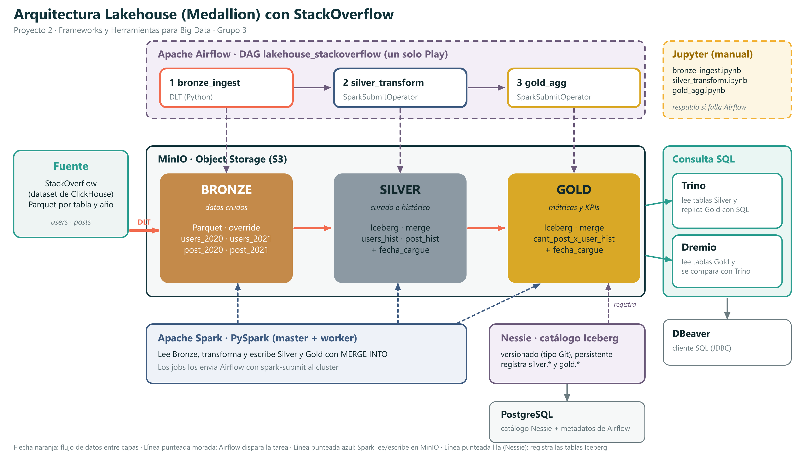

# Proyecto 2: Lakehouse con arquitectura Medallion sobre StackOverflow

Frameworks y Herramientas para Big Data, Universidad Autónoma de Occidente. Grupo 3.

Integrantes: Alejandro Cardenas Anturi, Samuel García Valencia, Juan Felipe Castellanos, Juan Sebastian Lozano Diaz y Valeria Franco Córdoba.

Armamos un Lakehouse open source que corre completo en Docker. Los datos son el dataset de StackOverflow de ClickHouse y
pasan por las tres capas Bronze, Silver y Gold. Airflow orquesta todo el pipeline con un solo Play.



## Qué hicimos

Cada capa guarda los datos de una forma distinta:

| Capa | Dónde y cómo se escribe | Qué tiene |
|---|---|---|
| Bronze | Parquet en MinIO, se sobrescribe | Los datos crudos de 2020 y 2021 de `users` y `post` |
| Silver | Tablas Iceberg, escritura con MERGE | `users_hist` y `post_hist`, ya limpias y con tipos correctos |
| Gold | Tabla Iceberg, escritura con MERGE | `cant_post_x_user_hist`, que cruza posts con usuarios |

Las tablas de Silver y Gold tienen la columna `fecha_cargue`, como pide el enunciado.

El DAG se llama `lakehouse_stackoverflow` y tiene tres tareas que se ejecutan en este orden:

1. `bronze_ingest`: DLT lee la fuente de `users` y deja `users_2021` en Bronze.
2. `silver_transform`: Spark consolida `users_hist` (2020 y 2021) con un MERGE sobre Iceberg.
3. `gold_agg`: Spark cruza `post_hist` con `users_hist` y hace el MERGE en `gold.cant_post_x_user_hist`.

Como dice la aclaración del enunciado, solo un año de un dataset pasa por el pipeline (`users_2021`). Lo demás se carga a mano una
sola vez antes de ejecutar el DAG: `post_2020`, `post_2021`, `users_2020` en Bronze y la tabla `post_hist` en Silver (sección 5).

## Servicios y accesos

| Servicio | Para qué lo usamos | Dirección | Usuario y contraseña |
|---|---|---|---|
| MinIO | Almacenamiento de objetos (buckets bronze, silver, gold y warehouse) | http://localhost:9001 | admin / password |
| Nessie | Catálogo de las tablas Iceberg, guarda su estado en PostgreSQL | http://localhost:19120 | no pide |
| Spark | Master y worker donde corren las tareas de Silver y Gold | http://localhost:9090 | no pide |
| Airflow | Orquesta el DAG | http://localhost:8081 | admin / admin |
| Jupyter | Notebooks para ejecutar las tareas a mano | http://localhost:8888 | no pide |
| Trino | Consulta Silver y replica Gold con SQL | http://localhost:8082 | usuario admin, sin contraseña |
| Dremio | Consulta Gold | http://localhost:9047 | admin / admin12345 |
| PostgreSQL | Base de datos de Airflow y de Nessie | solo interno | admin / password |

DLT no tiene página propia: corre dentro de la primera tarea del DAG. Las claves son de laboratorio y están en el `docker-compose.yml`.

## Requisitos

- Docker Desktop (o Docker Engine) con Docker Compose 2.17 o más nuevo.
- Mínimo 12 GB de memoria asignada a Docker. En reposo todo usa unos 5 GB, pero al correr el pipeline o las consultas pesadas de
  Trino sube a 8 o 9 GB. Si tienen otros proyectos de Docker prendidos, apáguenlos primero: cuando falta memoria Trino se reinicia solo
  y no deja ningún error en el log (nos pasó).
- Unos 25 GB libres de disco entre imágenes, datos y volúmenes.
- Internet la primera vez, para construir las imágenes y bajar los datos.

## Cómo levantarlo

```bash
git clone https://github.com/jslozanod/Proyecto-2-Lakehouse-StackOverflow.git
cd Proyecto-2-Lakehouse-StackOverflow

# construye las imágenes y levanta todos los servicios
docker compose up -d --build

# revisar que estén arriba (airflow-init y minio-init terminan solos, es normal)
docker compose ps

# configurar Dremio la primera vez (crea el usuario admin y la fuente Nessie)
bash scripts/dremio_init.sh
```

La primera construcción se demora porque baja las imágenes y los JARs de Spark. Esos JARs (Iceberg, Nessie y S3) quedan dentro de
la imagen de Spark, así que cuando se ejecuta el pipeline no se descarga nada.

Comandos que nos sirvieron:

```bash
docker compose logs -f airflow-scheduler    # ver los logs de Airflow
docker compose stop                         # apagar sin perder datos
docker compose up -d                        # volver a prender
docker compose down -v                      # borra todo, incluidos los volúmenes
```

## Datos y carga manual

El dataset es el de StackOverflow de ClickHouse: https://clickhouse.com/docs/getting-started/example-datasets/stackoverflow

Los archivos completos son enormes, así que usamos solo de enero a junio de cada año (el profesor dijo que se podía recortar). Usamos
los mismos meses en `users` y en `post` para que el cruce tenga coincidencias. El rango se cambia con las variables
`FECHA_DESDE_MES` y `FECHA_HASTA_MES` del `docker-compose.yml`.

```bash
# 5.1 Descargar los Parquet originales a data/raw (unos 6,6 GB; si se corta, se repite el mismo comando y continúa)
mkdir -p data/raw
B=https://datasets-documentation.s3.eu-west-3.amazonaws.com/stackoverflow/parquet
curl -L -C - -o data/raw/users.parquet      $B/users.parquet
curl -L -C - -o data/raw/posts_2020.parquet $B/posts/2020.parquet
curl -L -C - -o data/raw/posts_2021.parquet $B/posts/2021.parquet

# 5.2 Bronze manual: recorta y sube post_2020, post_2021 y users_2020 a MinIO (6 a 8 minutos)
docker compose exec jupyter python /workspace/jobs/bronze_manual.py

# 5.3 Silver manual: construye post_hist, el DAG solo construye users_hist (unos 3 minutos)
docker compose exec -e SILVER_TABLA=posts jupyter python /workspace/jobs/silver_transform.py
```

Si usan Git Bash en Windows, antepongan `MSYS_NO_PATHCONV=1` a esos dos `docker compose exec`, porque si no Git Bash cambia la ruta
`/workspace/...`. En PowerShell funcionan igual. Estos mismos pasos se pueden hacer desde los notebooks de Jupyter.

Después de la carga manual, MinIO debe tener esto:

```
bronze/post/2020/post_2020.parquet
bronze/post/2021/post_2021.parquet
bronze/users/2020/users_2020.parquet
silver/post_hist/
```

## Ejecutar el pipeline

1. Entrar a Airflow en http://localhost:8081 con admin / admin.
2. Buscar el DAG `lakehouse_stackoverflow` y darle Play (Trigger DAG).
3. Se ejecutan las tres tareas una detrás de otra. Las de Silver y Gold se mandan al clúster de Spark, se pueden ver en http://localhost:9090.

También se puede disparar por consola:

```bash
docker compose exec airflow-scheduler airflow dags trigger lakehouse_stackoverflow
```

Todo el DAG se demora alrededor de un minuto y medio. Al terminar aparecen estas rutas en MinIO:

```
bronze/users/2021/users_2021.parquet
silver/users_hist/
gold/cant_post_x_user_hist/
```

Se puede ejecutar varias veces sin problema. Bronze sobrescribe el mismo archivo, y las tablas de Silver y Gold se crean una sola vez
con una ubicación fija (`CREATE TABLE IF NOT EXISTS`) y después solo se actualizan con MERGE. No se crean tablas ni carpetas nuevas.

## Notebooks de respaldo

Por si Airflow falla, en Jupyter (http://localhost:8888, carpeta `notebooks/`) están los tres notebooks con la misma lógica de las tareas:

| Notebook | Equivale a | Qué hace |
|---|---|---|
| `bronze_ingest.ipynb` | Tarea 1 | Carga manual de Bronze y la ingesta con DLT de `users_2021` |
| `silver_transform.ipynb` | Tarea 2 | Construye `users_hist` y `post_hist` |
| `gold_agg.ipynb` | Tarea 3 | Genera `cant_post_x_user_hist` |

Los notebooks salen de los scripts de la carpeta `jobs/` (con `python scripts/make_notebooks.py`), por eso hacen exactamente lo mismo que el DAG.

## Consultas

### Trino: replicar Gold desde Silver

Para conectarse con DBeaver se usa el driver de Trino con `jdbc:trino://localhost:8082/lakehouse`, usuario `admin` y sin contraseña.
También se puede entrar por consola con `docker compose exec trino trino`.

En `sql/trino_replicar_gold.sql` están las consultas: lista las tablas de Silver, calcula otra vez la tabla de Gold leyendo solo de
Silver y la compara fila por fila con la tabla `gold.cant_post_x_user_hist`. La consulta de validación devuelve cinco números:
`filas_replica` y `filas_gold` tienen que ser iguales, y `solo_en_replica`, `solo_en_gold` y `filas_con_diferencias` tienen que dar 0.
Cuando lo corrimos dio 386.559 filas en la réplica y 386.559 en Gold, con 0 diferencias.

### Dremio: consultar Gold

Se entra a http://localhost:9047 con admin / admin12345. La fuente `nessie` la crea el script `scripts/dremio_init.sh`. Las consultas
están en `sql/dremio_consultar_gold.sql`. Con la consulta de los 5 usuarios con más posts se comparan los registros uno a uno contra Trino.

## Carpetas del repositorio

```
docker-compose.yml            los servicios, con comentarios
Dockerfile.spark              Spark 3.5.5 con los JARs de Iceberg, Nessie y S3
Dockerfile.airflow            Airflow 2.9.0 con Java 17, la misma distribución de Spark y DLT
Dockerfile.jupyter            JupyterLab con Spark, DLT y DuckDB
spark-defaults.conf           configuración de Spark (catálogo Nessie, S3 y recursos)
dags/                         el DAG con las tres tareas
jobs/                         bronze_ingest.py, bronze_manual.py, silver_transform.py, gold_agg.py
notebooks/                    los tres notebooks de respaldo
sql/                          consultas de Trino y de Dremio
trino/                        configuración de Trino y su catálogo
scripts/                      dremio_init.sh y el generador de notebooks
init/postgres-init.sql        crea la base de datos de Nessie
docs/                         el diagrama de la arquitectura
```

## Cosas que tuvimos que resolver

Dejamos anotado lo que nos dio problemas, por si a alguien le pasa lo mismo.

- **Tablas siempre en el mismo lugar.** Creamos las tablas Iceberg una sola vez con `LOCATION` explícito (`s3://silver/...` y
  `s3://gold/...`). Cuando las dejábamos con la ruta automática, cada ejecución llenaba el bucket de carpetas con sufijos al azar.
- **Nessie persistente.** Guarda su estado en PostgreSQL, así que sobrevive a los reinicios (lo probamos reiniciando el contenedor).
- **Spark sin descargas al ejecutar.** Airflow y Jupyter usan la misma distribución de Spark que el clúster, con los mismos JARs, y
  mandan las tareas con `SparkSubmitOperator`.
- **Airflow con LocalExecutor.** Con CeleryExecutor gastaba más memoria (Redis y workers extra) y no hacía falta.
- **Tipos de la fuente.** Los textos vienen como `binary` en el Parquet, así que en Silver se pasan a `string` y se tipan las columnas.
- **Java 17.** La imagen base de Spark trae Java 11 y la JVM de los ejecutores se caía (SIGSEGV) en Gold. Instalamos Java 17, igual
  que en el driver.
- **Lectura de Iceberg.** El lector vectorizado también tumbaba los ejecutores al leer tablas que ya tenían datos, entonces lo
  desactivamos (`spark.sql.iceberg.vectorization.enabled=false`) y escribimos con compresión snappy.
- **Promedio sin redondear.** La validación con Trino nos mostró una diferencia: un usuario con promedio exacto 1,025 aparecía como
  1,03 en Gold (Spark) y 1,02 en la réplica (Trino), porque redondean distinto. Guardamos `score_promedio` sin redondear, que da lo
  mismo en los dos motores, y se redondea solo al mostrarlo.

## Si algo falla

| Problema | Qué hicimos |
|---|---|
| `docker compose` no entiende `additional_contexts` | Actualizar Docker Compose a 2.17 o más nuevo. |
| La imagen de MinIO da error 401 o 403 al bajarla | Usamos `minio/minio` de Docker Hub, que es la que trae el compose. La de quay.io nos daba 401. |
| Un contenedor se cierra con código 137 | Falta memoria. Subir el límite en Docker Desktop (Settings, Resources) y apagar otros proyectos. |
| Un puerto ocupado (8081, 9000, 9001, 9047, 19120) | Apagar lo que lo usa, o cambiar el puerto de la izquierda en el `docker-compose.yml`. |
| Dremio no muestra la fuente `nessie` | Volver a correr `bash scripts/dremio_init.sh`, se puede repetir sin problema. |
